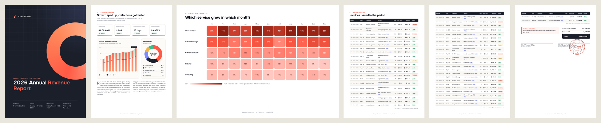

# Example: annual report

A six-page report built from one HTML template and one JSON file, then finished with pidief's own
commands. Open [annual-report.pdf](annual-report.pdf) to see the result.



## What it shows

Things that HTML-to-PDF tools without a modern browser engine (wkhtmltopdf, WeasyPrint, LibreOffice)
cannot do or do only partly:

| Page | What is hard about it |
|---|---|
| 1. Cover | Full-bleed design with no margins and no footer (a named `@page cover { margin: 0 }`), `conic-gradient` and CSS `mask` |
| 2. Summary | Bar and line chart drawn by JavaScript as SVG before printing (pidief waits for `window.ready`); donut chart from `conic-gradient`; two-column justified text with hyphenation and a drop cap |
| 3. Heatmap | A **landscape page inside a portrait document** (`@page wide { size: A4 landscape }`) |
| 4–6. Invoice register | 46 rows across three pages: the header row repeats on every page and no row is split at a page break |
| 6. Totals | Amount in words, signature lines and an approval seal over the signature |

Then the printed PDF goes through three more pidief steps:

1. `stamp` adds "Page X of Y" to every page except the cover (`--pages "2-"`, `%p` and `%P`).
2. `stamp` places [seal.png](seal.png), a transparent PNG, on the last page (`--pages l`).
3. `pdfa` converts the result to PDF/A-2b.

Money, numbers and dates are formatted in the page with `Intl` (en-US). pidief's template helpers
(`para`, `tarih`, `yaziyla`) format for Turkish, so this English example does not use them.

## Build it

```bash
./build.sh
```

`build.sh` uses `pidief` from `PATH`; set `PIDIEF=/path/to/pidief` to use another binary. It needs a
Chromium-based browser on the machine, or run the same commands against the Docker image's HTTP API.

The seal is not made by pidief. [make-seal.py](make-seal.py) draws it with Pillow from the Onest fonts in
`internal/assets/fonts`:

```bash
python make-seal.py
```

All names and numbers in `data.json` are made up.
